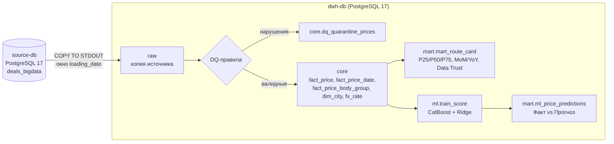

# Freight Rates Platform: ETL → DWH → ML

Прототип платформы аналитики и прогнозирования ставок грузоперевозок (тестовое задание Middle Data Engineer).
Источник сделок `deals_bigdata` (PostgreSQL 17) → идемпотентный ETL с контролем качества → Core DWH →
витрина «Карточка маршрута и рыночный коридор» → ML-прогноз справедливого тарифа с пакетным скорингом в БД.

```bash
docker-compose up
```

Команда поднимает источник (схема + детерминированный генератор на 300 000 сделок), DWH, прогоняет весь конвейер
и автотесты. После завершения контейнера `pipeline` DWH остаётся доступен на `127.0.0.1:5433` (`postgres` / `dwh_dev_password`).

---

## Архитектура



| Слой | Что лежит | Как обновляется |
|---|---|---|
| `raw` | Сделки окна, их `price_body_types` и `price_dates`; справочники `cities`, `body_types`, `exchange_rates` | Окно: DELETE + INSERT через staging; справочники: полная перезаливка |
| `core` | Очищенные и нормализованные факты (RUB, категории, группы кузова), дедуплицированные города, курсы ЦБ, карантин DQ | DELETE окна + INSERT в той же транзакции, что и raw |
| `mart` | Витрина маршрутов, представления для BI, прогнозы и метрики моделей | Витрина: атомарный пересчёт; прогнозы: UPSERT по `(price_id, model_name)` |
| `meta` | Журнал запусков ETL со статистикой | INSERT на каждый запуск |

**Почему так:**
- **Две отдельные БД** (источник и DWH) моделируют реальный перенос данных между системами, а не `INSERT ... SELECT` внутри одной базы.
  Перенос идёт потоком `COPY ... TO STDOUT → COPY ... FROM STDIN`: без построчных вставок и без промежуточных файлов.
- **Трансформации на SQL (ELT)** внутри DWH: 300 тыс. сделок обрабатываются за секунды, логика правил видна в одном месте
  (`sql/etl/*.sql`), а правила (категории веса/объёма, группы кузова) оформлены как `IMMUTABLE`-функции и покрыты тестами.
- **PostgreSQL 17** как единое хранилище по требованию задания; объёмы прототипа не требуют колоночной СУБД.
- **CatBoost** — нативная работа с категориями (регионы, города, кузов) без one-hot; Ridge оставлен как линейный бейзлайн.
- **Оркестратор:** шаги запускаются последовательно контейнером `pipeline` (`docker/pipeline/entrypoint.sh`).
  Каждый шаг — отдельная CLI-команда с параметрами окна, поэтому переносится в DAG Airflow один к одному.

---

## Запуск

```bash
docker-compose up                       # полный прогон (первый старт: ~1 мин генерация источника + ~2-3 мин конвейер)
docker-compose up --build pipeline      # повторный прогон конвейера (идемпотентен)
```

Параметры (все со значениями по умолчанию, см. `.env.example`): `AS_OF` (дата снимка, `2026-10-26`), окно ETL
`ETL_START_DATE` / `ETL_END_DATE`, `N_PRICES`, `RANDOM_SEED`, `RUN_TESTS`, пароли и порт DWH.

### Отдельные шаги и backfill

```bash
docker-compose run --rm pipeline migrate                                            # DDL (идемпотентно)
docker-compose run --rm pipeline etl --start-date 2026-09-01 --end-date 2026-09-30  # перезагрузка окна
docker-compose run --rm pipeline marts                                              # пересчёт витрин
docker-compose run --rm pipeline ml                                                 # обучение и скоринг
docker-compose run --rm pipeline test                                               # автотесты
```

Повторный запуск ETL за то же окно атомарно перезаписывает его: выгрузка в raw, перезапись core и карантина
идут в одной транзакции DWH (`DELETE` окна + `INSERT`), источник читается одним снимком `REPEATABLE READ`.
Если сделка при повторной выгрузке сменила `loading_date`, её прежняя версия удаляется по `id`, дубля не будет.
Каждый запуск пишет строку в `meta.etl_runs` со статистикой и сверяет баланс: `загружено в core + в карантине = выгружено`.

---

## Этап 1. ETL и качество данных

Код: `etl/run.py`, `sql/etl/010_refresh_dimensions.sql`, `sql/etl/020_load_core_window.sql`.

| Правило | Код причины в карантине |
|---|---|
| `price <= 0` или `NULL` | `PRICE_NON_POSITIVE` |
| RUB и `price <= 1000` (source-validation) | `RUB_PRICE_BELOW_MIN` |
| `distance <= 0` | `DISTANCE_NON_POSITIVE` |
| `total_weight < 0`, `total_volume < 0` | `WEIGHT_NEGATIVE`, `VOLUME_NEGATIVE` |
| город отправления / назначения не найден в `cities` | `LOADING_CITY_UNKNOWN`, `UNLOADING_CITY_UNKNOWN` |
| валюта не 643/840/978 | `CURRENCY_UNKNOWN` |
| USD/EUR без точного курса на `nearest_rate_date` | `FX_RATE_MISSING` |

- Строка с несколькими нарушениями получает все причины (PK `(price_id, reason_code)`), исходная строка сохраняется в `raw_row jsonb`.
- **Валюта:** `price_rub = price × rate`, где курс берётся строго на дату `nearest_rate_date` (её production заполняет по `created_at`).
  Fallback по `loading_date` не используется, для RUB курс = 1.
- **Категории:** пропуски `weight_category` заполняются по весу, округлённому до 0.1 т (`G20T ≥ 30`, `FTL [10;30)`, `10T [5;10)`,
  `5T [2.5;5)`, `L5T [0.5;2.5)`, иначе `OTH`), `volume_category` = `FTL` при `0 < V ≤ 120`, иначе `OTH`.
  Флаги `*_category_filled` показывают, что значение рассчитано, а не пришло из источника.
- `loading_city_gcid = unloading_city_gcid` не отбраковывается: в production это не DQ-правило.
- **`outlier_mark`** используется как входной флаг и не пересчитывается (см. «Ограничения данных»).

Результат на эталонном датасете (300 000 сделок):

| Показатель | Значение |
|---|---|
| Выгружено из источника | 300 000 |
| Загружено в `core.fact_price` | 299 797 |
| В карантине | 203 (164 `PRICE_NON_POSITIVE`, 39 `FX_RATE_MISSING`) |
| Время ETL полного окна | ~40 с |

## Этап 2. DWH и витрина маршрутов

Код: `sql/dwh/001_schemas.sql`, `sql/mart/010_refresh_route_card.sql`, `sql/mart/020_views.sql`.

- **Дедупликация городов:** `core.dim_city` — одна строка на `gc_id` (минимальный `cities.id`), город и регион
  разобраны из `full_name_local` («Казань, Республика Татарстан» → `Казань` / `Республика Татарстан`).
- **Группы кузова:** `core.fact_price_body_group` — одна строка на (сделка, группа). Коды 1С маппятся в группы явно:
  Тент (56-61), Рефрижератор (4, 46-48), Изотерм (2), Борт (1, 15), Прочие, Не указан. Если у сделки нет
  `price_body_types`, берётся `prices.body_type`, затем «Не указан». Сделка с кузовами из разных групп
  (тент + борт) учитывается в обеих группах, но внутри одной группы - один раз.
- **Зерно витрины `mart.mart_route_card`:** месяц из `price_dates.price_date` × город отправления × город назначения ×
  группа кузова × весовая категория. Долгосрочная заявка попадает во все свои месяцы. `volume_category`
  в зерно не включена: в требованиях её нет, а у сделок одной ячейки она бывает разной.
- **Фильтр рынка:** `is_fact` (`price_type IN (1,2,3,4,5,9)`), `NOT complex`, `price > 0`, `distance > 0`,
  есть `price_rub`, `NOT outlier_mark`, `price_date <= as_of`.
- **Метрики:** `p25/median/p75/avg_trip`, `p25/median/p75_km`, `trips_count`, `carriers_count`
  (`COUNT(DISTINCT organization_id)` при `price_type IN (3, 9)`), `cv_rate` (`NULL` при < 2 наблюдениях или нулевом среднем),
  `mom_pct` / `yoy_pct` к строго календарным соседним ячейкам (нет ячейки → `NULL`).
- **Надёжность:** `HIGH` при `trips_count ≥ 30`, `carriers_count ≥ 5` и `freshness_days ≤ 30`, `MEDIUM` при `trips_count ≥ 10`,
  иначе `LOW_DATA`. Свежесть = `as_of − last_deal_date`, где `last_deal_date` - последняя `price_date` в ячейке.
- Витрина пересчитывается целиком в транзакции: перцентили не агрегируются инкрементально, а на 300 тыс. сделок это ~12 с.
  Для production-объёмов следующий шаг - пересчёт только затронутых месяцев (плюс соседних для MoM/YoY).

Итог: 203 644 ячейки, 37 месяцев, 1 560 направлений; `HIGH` 10, `MEDIUM` 924, `LOW_DATA` 202 710
(мелкое зерно «маршрут × кузов × вес × месяц» на синтетике закономерно даёт много разреженных ячеек).

Представления для BI:
- `mart.v_route_network_latest` — последний месяц по каждой ячейке (сводная таблица сети для тендеров);
- `mart.v_ml_fact_vs_forecast` — прогнозы рядом с фактом и рыночным коридором месяца, флаг `above_market_p75`.

### Проверочные запросы

```bash
docker-compose exec dwh-db psql -U postgres -d dwh
```

```sql
-- Карточка маршрута: помесячная история коридора Москва -> Казань, тент, FTL
SELECT month, p25_trip, median_trip, p75_trip, median_km, trips_count, carriers_count,
       cv_rate, mom_pct, yoy_pct, reliability_level
FROM mart.mart_route_card
WHERE loading_city = 'Москва' AND unloading_city = 'Казань' AND body_group = 'Тент' AND weight_category = 'FTL'
ORDER BY month DESC;

-- Сводная таблица сети: самые надёжные направления последнего месяца
SELECT loading_city, unloading_city, body_group, weight_category, median_trip, median_km,
       trips_count, carriers_count, mom_pct, reliability_level
FROM mart.v_route_network_latest
WHERE month = '2026-10-01' AND reliability_level <> 'LOW_DATA'
ORDER BY trips_count DESC LIMIT 20;

-- Карантин DQ по причинам
SELECT reason_code, count(*) FROM core.dq_quarantine_prices GROUP BY 1 ORDER BY 2 DESC;

-- Факт vs прогноз: рейсы, закрытые заметно выше прогноза
SELECT price_id, loading_date, loading_city, unloading_city, body_group,
       actual_price_rub, predicted_price_rub, ape_pct, median_trip
FROM mart.v_ml_fact_vs_forecast
WHERE scoring_period = 'test' AND actual_price_rub > predicted_price_rub * 1.3
ORDER BY ape_pct DESC LIMIT 20;

-- Метрики моделей
SELECT model_name, n_train, n_test, metrics FROM mart.ml_model_runs ORDER BY model_name;

-- Журнал запусков ETL
SELECT run_id, window_start, window_end, status, stats->>'rows_loaded_core' AS loaded,
       stats->>'rows_quarantined' AS quarantined FROM meta.etl_runs ORDER BY run_id DESC LIMIT 5;
```

## Этап 3. ML: признаки, обучение, пакетный скоринг

Код: `ml/features.py`, `ml/train_score.py`, `ml/metrics.py`.

- **Выборка:** фактические прямые сделки из core (`is_fact`, `NOT complex`, `price > 0`, `distance > 0`), `target = price_rub`.
- **Разбиение строго по `loading_date` от `as_of`** (не от системной даты):
  `train = [2026-07-26; 2026-10-05)`, `test = [2026-10-05; 2026-10-26]`, `future = loading_date > 2026-10-26`.
  Граница `2026-10-05` входит только в test; перемешивания нет.
- **Признаки:** регион и город отправления/назначения раздельно (дедуплицированный справочник, минимальный `cities.id`),
  координаты, `distance`, `total_weight`, `total_volume`, группа кузова, весовая и объёмная категории, тип записи
  `price_type`, год, месяц, день недели, день года и их `sin/cos` (T = 12, 7, 365.25).
- **Защита от утечек:** в признаках нет ни таргета и его производных (`price_rub / distance`, `price / weight`, ставка с НДС,
  маржа), ни `price_group_stats` (`avg_price`, `min/max_km_price`, `price_group_id`), ни `outlier_mark`.
  Список запрещённых полей проверяется в коде и в тестах. Все статистики очистки и препроцессинга (IQR, imputer,
  scaler, one-hot) считаются только на train.
- **Очистка таргета:** по `outlier_mark`, затем по IQR от `ln(price_rub / distance)` в группах «кузов × вес»
  с границами по train (убирает 340 из 24 226 строк train; см. «Ограничения данных»). Test не чистится этим фильтром.
- **CatBoost:** число деревьев подбирается ранней остановкой на последних 2 неделях train, затем модель
  переобучается на всём train. `random_seed` фиксирован.
- **Скоринг:** test-период (включая размеченные выбросы, с флагом `outlier_mark`) и будущие заявки. UPSERT в
  `mart.ml_price_predictions`; у будущих заявок `actual_price_rub`, `abs_error_rub`, `ape_pct` = `NULL`
  (гарантируется ещё и `CHECK`-ограничением). Модель и метрики сохраняются в том `ml-artifacts`.

### Метрики на test (n = 12 808, без размеченных выбросов)

| Модель | R² | MAPE | RMSE, ₽ | MAE, ₽ |
|---|---:|---:|---:|---:|
| **CatBoostRegressor** | **0.927** | **14.6%** | **51 863** | **26 726** |
| Ridge (one-hot + scaler) | 0.843 | 48.9% | 75 736 | 47 143 |

Это сопоставимо с ориентиром R&D-отчёта (CatBoost R² ≈ 0.93, MAPE ≈ 13%). Без строк за `2026-10-26`, ещё не прошедших
разметку выбросов, CatBoost даёт R² 0.925 и MAPE 14.7%. Главные признаки: `distance` (≈ 64%), `total_weight`,
группа кузова и весовая категория. `year` имеет нулевой вес закономерно: train-окно целиком внутри 2026 года, тренд
между годами моделью из 3 месяцев не выучить. Для учёта инфляции нужно более длинное окно обучения.

---

## Ограничения данных и принятые решения

1. **Сделки последнего дня снимка (`2026-10-26`) не размечены по выбросам**: ночной job ещё не прошёл, у них
   `outlier_mark = false`. Они попадают в витрину октября и в test как есть. Для прозрачности метрики модели
   приводятся и без этого дня.
2. **Часть экстремальных ставок не помечена `outlier_mark`** и вне последнего дня: в генераторе множитель ×4 / ×0.25
   применяется при `r_out > 0.988` / `< 0.012`, а флаг ставится только при `> 0.990` / `< 0.010`. В core это
   ≈ 1 000 сделок (0.4%). Флаг в базовом решении не пересчитывается (по требованию), поэтому в витрине такие
   сделки остаются и могут раздувать `cv_rate` и `p75` в отдельных ячейках. В ML их отсекает train-only IQR.
   Следующий шаг - пересчёт выбросов по логике `MarkOutlierPrices` (группа `price_group_id` от 4 строк, IQR по `price`,
   P5-P95 по `price_km`) отдельным опциональным флагом, не заменяющим `outlier_mark`.
3. **Свежесть для `HIGH`** трактуется как `as_of − последняя price_date ячейки ≤ 30 дней`.
4. **`price_group_stats` не выгружается в DWH** вовсе: для витрин он не нужен, а для ML запрещён.
5. `price_type = 6` (торги) хранится в core с флагом `is_fact = false`, но в витрину и ML не попадает.

## Тесты

```bash
docker-compose run --rm pipeline test
```

51 тест (`pytest`): правила категорий и групп кузова на границах, дедупликация городов, отсутствие невалидных
строк в core, баланс «core + карантин = raw», конвертация по точному курсу, уникальность зерна витрины, независимый
пересчёт ячейки, строгость MoM/YoY, уровни надёжности, `NULL` у будущих прогнозов, границы train/test,
отсутствие утечек в признаках, циклическое кодирование, train-only IQR и **идемпотентность**:
двойной прогон ETL за два окна (в т.ч. с будущими заявками) и двойной пересчёт витрин не меняют ни числа строк,
ни сумм, ни перцентилей.

## Структура репозитория

```
docker-compose.yml, .env.example
docker/pipeline/      Dockerfile и entrypoint конвейера
docker/postgres/      инициализация источника (schema.sql + synthetic.sql)
sql/source/           эталонная схема и генератор источника (из задания)
sql/dwh/              DDL слоёв raw / core / mart / meta и функции правил
sql/etl/              трансформации raw -> core (DQ, карантин, нормализация)
sql/mart/             витрина маршрутов и представления BI
etl/                  CLI: migrate, run (окно дат), marts
ml/                   признаки, обучение, метрики, batch scoring
tests/                unit и интеграционные тесты
```

## Что не сделано из бонусной части

Airflow, Superset и ClickHouse не подключены: фокус на обязательной части и её надёжности.
Шаги уже оформлены как независимые идемпотентные CLI-команды с параметрами окна, поэтому DAG Airflow сводится к
`etl(logical_date) >> marts >> ml`, а витрина `mart_route_card` подключается к Superset как обычная таблица PostgreSQL.
